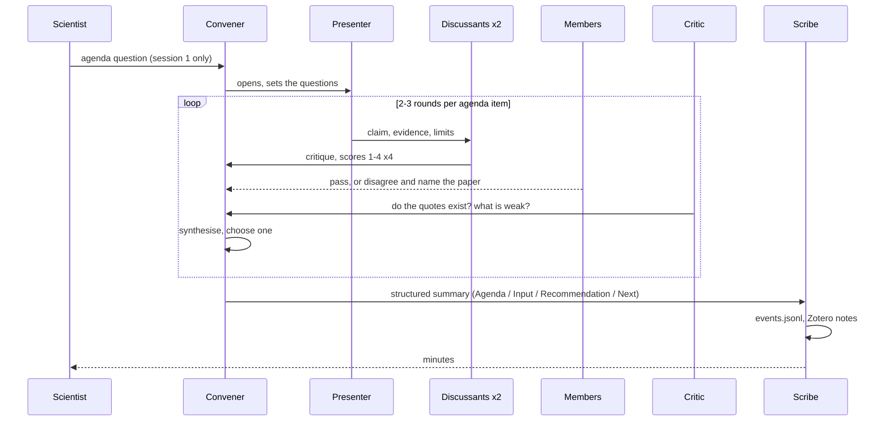

# The Library Journal Club as one lab

*Schematic source: [journal_club_schematic.svg](journal_club_schematic.svg). Editable in any text editor or by importing into draw.io.*

One lab, run the way Virtual Lab runs a team meeting: a convener chairs, a standing critic speaks last, a scribe keeps the minutes, and the twenty papers sit in one meeting with one shared transcript. The review rubric and the archive come from ASCollab; the dispute step is ours.

## Roles

| Role | Who | Does | Source |
| --- | --- | --- | --- |
| Scientist | Human | Writes the agenda question once; reads the minutes; settles `unresolved` | Virtual Lab (1.3% of words) |
| Convener | One agent, strongest model | Opens the meeting, sets the questions, synthesises each round, rules on disputes, must "choose one" | Virtual Lab PI |
| Critic | One agent, standing | Speaks last every round; checks rigour and that every quote exists in the source; feedback only | Virtual Lab Critic |
| Scribe | One agent, cheap model | Writes the structured summary and the Zotero notes; never argues | Virtual Lab summary format |
| Presenter | One paper per turn | States its claim, evidence, limits | Paper agent |
| Discussants | The 2 papers nearest the presenter | Score Support, Soundness, Significance, Originality 1-4 | ASCollab K=2 |
| Members | The other 17 papers | May say "pass", or disagree and name the paper | Virtual Lab team prompt |

Every agent is four fields: title, expertise, goal, role (Virtual Lab). Discussants are ordinary papers with a second system prompt for the turn.

## One session

Rules that keep it short:

- One shared transcript; each turn swaps the system prompt (Virtual Lab `run_meeting`). Cap at 5 speaking papers per agenda item; the rest listen.
- Only the convener's summary leaves the meeting; the transcript stays in the lab.
- Disputes: when two papers' claims clash, each defends with quotes for 2 turns; the convener rules `stands`, `contested` or `unresolved`. `unresolved` goes to the scientist.
- The convener must choose one answer per question (agents hedge unless forced).

## Three sessions overnight

```mermaid
flowchart LR
    accTitle: Three sessions overnight
    accDescr: Session one is introductions, where every paper presents in turn. Session two is the debate on the conflicts the convener listed. Session three is proposals, where the convener pairs papers and the final minutes are written.

    agenda["🧑‍🔬 Agenda<br/>10 pm"]
    s1["🔵 Session 1: Introductions<br/>each paper presents in turn<br/>convener lists the conflicts"]
    s2["🟠 Session 2: Debate<br/>papers in conflict argue, 2 turns<br/>stands / contested / unresolved"]
    s3["🟢 Session 3: Proposals<br/>convener pairs papers, one idea per pair<br/>final minutes"]
    morning["☀️ Morning<br/>minutes, Zotero notes,<br/>unresolved for the scientist"]

    agenda --> s1
    s1 -- "claim per paper, conflict list" --> s2
    s2 -- "verdicts" --> s3
    s3 --> morning

    classDef one fill:#dbeafe,stroke:#2563eb,stroke-width:2px,color:#1e3a5f
    classDef two fill:#ffedd5,stroke:#ea580c,stroke-width:2px,color:#7c2d12
    classDef three fill:#dcfce7,stroke:#16a34a,stroke-width:2px,color:#14532d
    classDef person fill:#fef9c3,stroke:#ca8a04,stroke-width:2px,color:#713f12

    class s1 one
    class s2 two
    class s3 three
    class agenda,morning person
```

| | Session 1: Introductions | Session 2: Debate | Session 3: Proposals |
| --- | --- | --- | --- |
| Who speaks | Every paper once, 2 discussants each | Only the papers in conflict | One pair at a time, ~4 pairs |
| Convener decides | The conflict list | Verdicts, cap 5 disputes | Which proposals to keep |
| Critic checks | Quotes exist | Whose evidence holds | Feasibility |
| Scribe writes | Claim per paper, first Zotero notes | Verdict per dispute, red edges | Proposals, green edges, final minutes |

Budget: session 1 ≈ 20 × (presenter + 2 discussants + critic + convener) ≈ 100 calls; session 2 ≈ 5 disputes × 6 ≈ 30; session 3 ≈ 4 pairs × 6 ≈ 25; scribe ≈ 15. **About 170 calls for the night.**

## Why one lab

Twenty papers is the size of one reading group, and the review in [organisation_structure.md](organisation_structure.md) favours a chair who synthesises and summaries that travel instead of transcripts (Virtual Lab, MetaGPT, ChatDev, MacNet). Splitting into topic groups adds a layer of leads and summaries that only pays off above ~16 active participants per meeting (MacNet's saturation point); with 5 speaking papers per item there is no need. ASCollab's flat society is kept only in the rubric and the archive; its missing dispute step is session 2.
