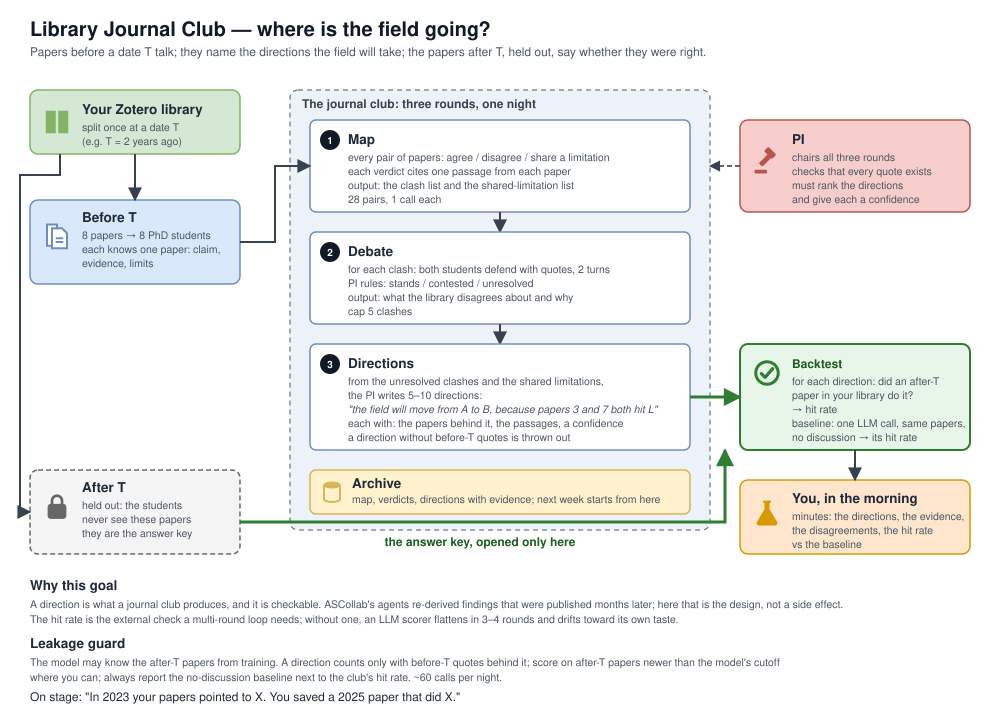
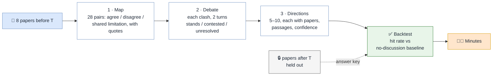

# The Library Journal Club: where is the field going?

*Source: [journal_club_schematic.svg](journal_club_schematic.svg). Editable in a text editor or by importing into draw.io.*

The club has one goal: given the papers you have read, say where the field goes next. That goal is checkable. Split the library at a date T, let the papers before T talk, and score their directions against the papers after T, which they never saw. ASCollab's agents re-derived findings that were published months later as a side effect ([ascollab.md](ascollab.md) §7); here it is the design.

## Parts

| Part | Who | Does |
| --- | --- | --- |
| Your library | Zotero | Split once at a date T (e.g. two years ago). |
| Before T | 8 papers → 8 PhD-student agents | Each knows one paper: claim, evidence, limits. |
| After T | Held out | The students never see them. They are the answer key, opened only by the backtest. |
| PI | One agent | Chairs the three rounds, checks every quote exists, ranks the directions and gives each a confidence. |
| Archive | One file | Map, verdicts, directions with evidence. Next week's club starts from it. |
| Backtest | A script plus one LLM judge | For each direction: did an after-T paper do it? Hit rate, next to a no-discussion baseline. |
| You | The human | Set T and the field; read the minutes in the morning. |

## One night, three rounds

| Round | Input | Output | Calls |
| --- | --- | --- | --- |
| 1 · Map | 8 papers | For each of 28 pairs: agree / disagree / share a limitation, each citing one passage per paper. The clash list and the shared-limitation list. | 28 |
| 2 · Debate | The clash list, cap 5 | Both students defend with quotes for 2 turns; the PI rules stands / contested / unresolved. | ~25 |
| 3 · Directions | Unresolved clashes + shared limitations | 5–10 directions: "the field will move from A to B, because papers 3 and 7 both hit L", each with the papers, the passages, a confidence. A direction without before-T quotes is thrown out. | ~5 |
| Backtest | Directions + after-T papers | Hit rate; same for one LLM call with the same papers and no discussion. | ~10 |

About 60–70 calls per night.

## Why this goal

- It is what a journal club produces. People leave a reading group with "someone should do X", not with a method-on-dataset combination.
- It is checkable. The hit rate is the external evaluator that the self-improvement literature says any multi-round loop needs ([rsi.md](rsi.md) §c); without one, an LLM scorer flattens in 3-4 rounds and drifts toward its own taste.
- Dissent is the raw material. Directions come from the clashes and shared limitations that round 1 surfaces and a single summary averages away.
- It is a demo line: "In 2023 your papers pointed to X; you saved a 2025 paper that did X."

## Leakage guard

The model may already know the after-T papers from training. Three rules, cheapest first:

1. A direction counts only if it rests on quoted before-T passages. A correct guess without evidence is a miss.
2. Score on after-T papers newer than the model's training cutoff where you can.
3. Always report the no-discussion baseline next to the club's hit rate. The claim is that the conversation added something, and the baseline is how you show it.

## What was dropped, and where it went

The earlier versions ([organisation_structure.md](organisation_structure.md) §4) had topic groups, group leads, meta-review tournaments, Elo and a self-improvement claim. None of it is needed for this goal. The archive is kept as memory so next week's club does not re-argue settled clashes. Self-improvement, if wanted later, is one addition: the PI rewrites the direction-writing prompt between weeks and the diff goes in the minutes.
