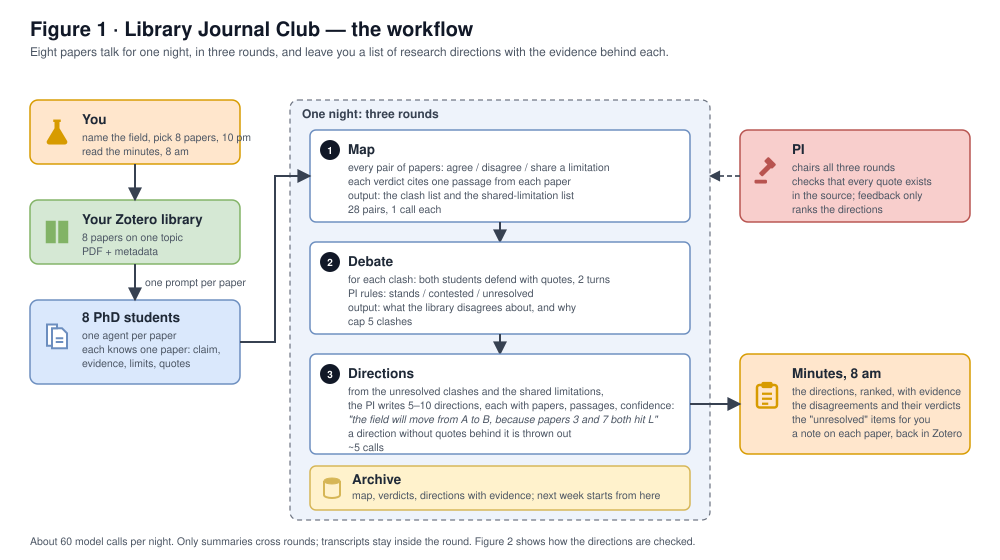
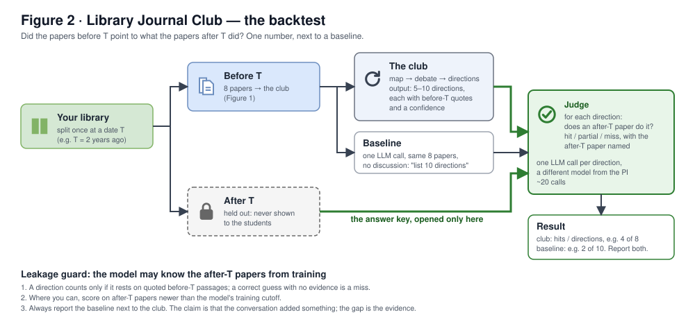

# The Library Journal Club: workflow and backtest

Two figures. Figure 1 is what runs every night. Figure 2 is how you check it. Sources: [journal_club_workflow.svg](journal_club_workflow.svg), [journal_club_backtest.svg](journal_club_backtest.svg); editable in a text editor or by importing into draw.io.

## Figure 1: the workflow

Eight papers from your Zotero library become PhD-student agents, one per paper. In one night they run three rounds under a PI who checks every quote. You get the minutes in the morning.

| Part | Who | Does |
| --- | --- | --- |
| You | The human | Name the field and pick 8 papers at 10 pm; read the minutes at 8 am. |
| 8 PhD students | One agent per paper | Each knows one paper: claim, evidence, limits, quotes. |
| PI | One agent | Chairs the three rounds, checks every quote exists in the source, ranks the directions. Feedback only. |
| Archive | One file | Map, verdicts, directions with evidence. Next week's club starts from it. |
| Minutes | Written from the archive | Ranked directions with evidence, the disagreements and verdicts, the `unresolved` items, a note on each paper back in Zotero. |

| Round | Input | Output | Calls |
| --- | --- | --- | --- |
| 1 · Map | 8 papers | For each of 28 pairs: agree / disagree / share a limitation, with one passage per paper. The clash list and the shared-limitation list. | 28 |
| 2 · Debate | The clash list, cap 5 | Both students defend with quotes for 2 turns; the PI rules stands / contested / unresolved. | ~25 |
| 3 · Directions | Unresolved clashes + shared limitations | 5–10 directions, "the field will move from A to B, because papers 3 and 7 both hit L", each with papers, passages, confidence. No quotes, no direction. | ~5 |

About 60 calls per night. Only summaries cross rounds; transcripts stay inside the round.

## Figure 2: the backtest

Split the library once at a date T. Only the papers before T go into the club. The papers after T are held out and never shown to the students; they are the answer key. A judge checks each direction against them and reports a hit rate, next to the same count for one LLM call with no discussion.

| Part | Does | Calls |
| --- | --- | --- |
| Before T | The 8 papers the club sees (Figure 1). | — |
| After T | Held out. Opened only by the judge. | — |
| The club | Map → debate → directions, with before-T quotes and a confidence. | ~60 |
| Baseline | One LLM call, the same 8 papers, "list 10 directions". No discussion. | 1 |
| Judge | For each direction: does an after-T paper do it? hit / partial / miss, naming the paper. A different model from the PI. | ~20 |
| Result | Club: hits / directions, e.g. 4 of 8. Baseline: e.g. 2 of 10. Report both. | — |

### Leakage guard

The model may know the after-T papers from training.

1. A direction counts only if it rests on quoted before-T passages. A correct guess with no evidence is a miss.
2. Where you can, score on after-T papers newer than the model's training cutoff.
3. Always report the baseline next to the club. The claim is that the conversation added something; the gap is the evidence.

On stage: "In 2023 your papers pointed to X. You saved a 2025 paper that did X."

## Why this goal

- A direction is what a journal club produces. People leave a reading group with "someone should do X".
- It is checkable. The backtest is the external evaluator that any multi-round LLM loop needs ([rsi.md](rsi.md) §c); without one, scores flatten in 3-4 rounds and drift toward the scorer's taste.
- Dissent is the raw material. Directions come from the clashes and shared limitations that round 1 surfaces and a single summary averages away.
- ASCollab's agents re-derived findings that were published months later as a side effect ([ascollab.md](ascollab.md) §7). Here it is the design.

## What was dropped, and where it went

Earlier versions ([organisation_structure.md](organisation_structure.md) §4) had topic groups, group leads, meta-review tournaments, Elo and a self-improvement claim. None of it is needed for this goal. The archive is kept as memory. Self-improvement, if wanted later, is one addition: the PI rewrites the direction-writing prompt between weeks and the diff goes in the minutes.
