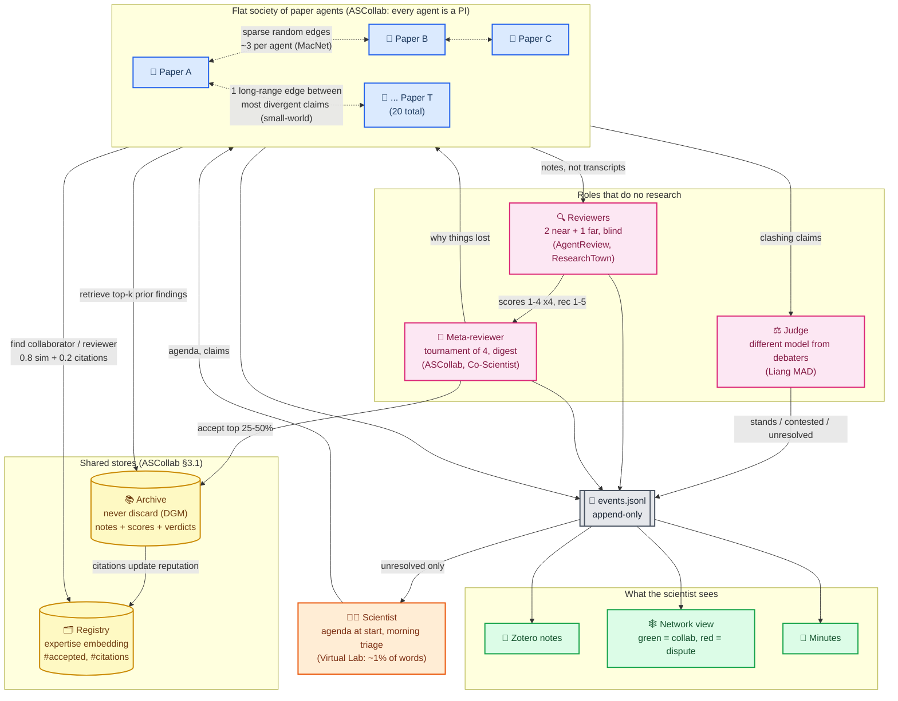
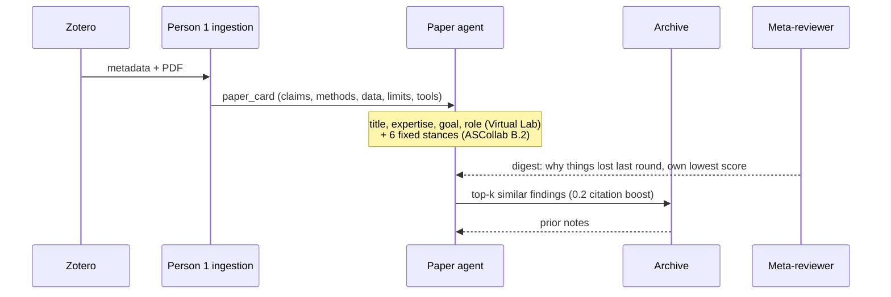
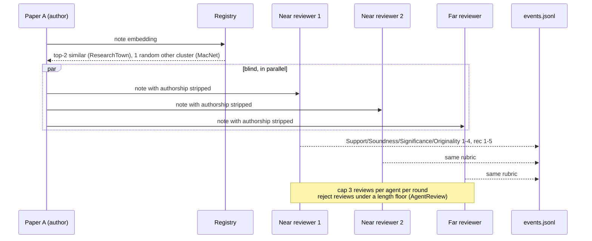
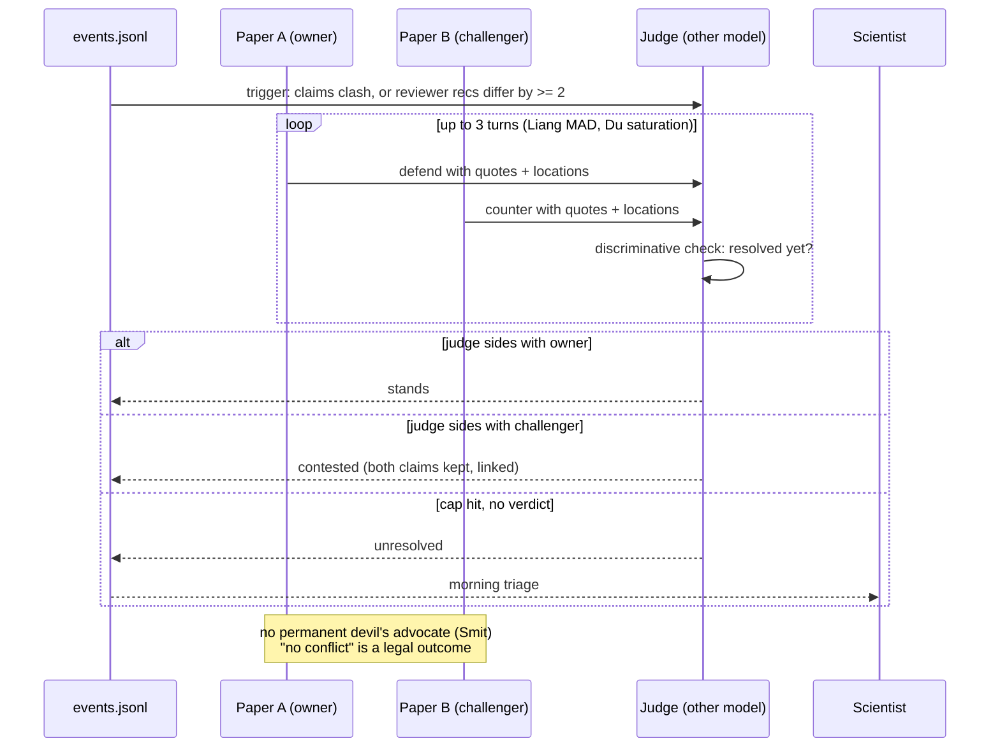
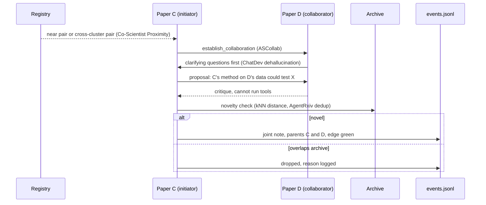
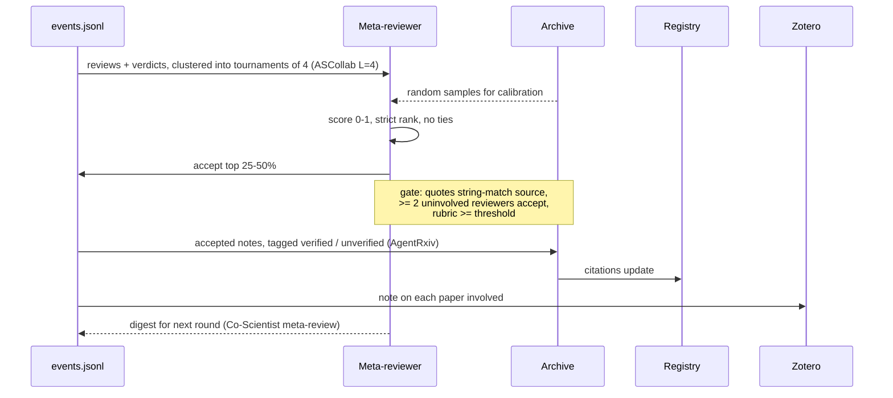
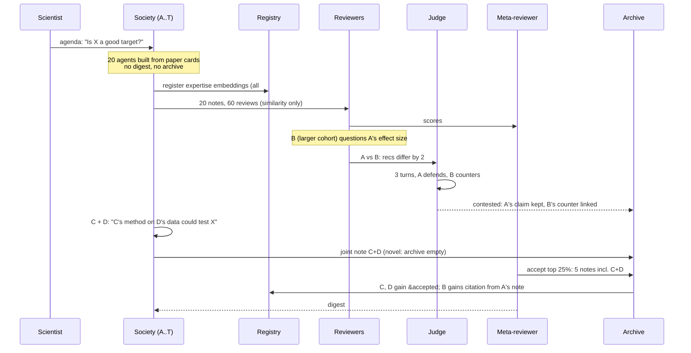
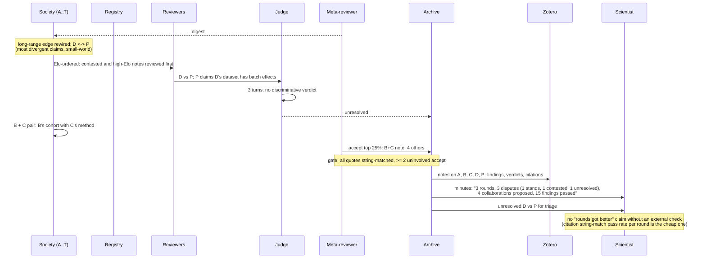

# Organisation structure of the Library Journal Club society

Diagrams for recommendations §4 of [organisation_structure.md](organisation_structure.md) and §1-2 of [synthesis.md](synthesis.md). First the whole organisation, then each step as an interaction, then three full cycles showing what changes between rounds. Each element names the paper it comes from.

## 🏛️ The whole organisation



Structural decisions, with their source:

| Decision | Choice | Why | Source |
| --- | --- | --- | --- |
| Hierarchy | Flat; no PI agent | Papers are peers; a PI would average dissent away | ASCollab §3 |
| Who may talk to whom | Sparse random edges, ~3 per agent, plus one long-range edge | Random DAGs beat mesh at half the time; ~16 nodes is the useful range | MacNet, small-world |
| What travels on an edge | Structured notes only, never transcripts | Linear context growth; models attend to latest turns anyway | MacNet, ChatDev, Virtual Lab, Du et al. |
| Reviewers | Drawn from the agents, 2 near + 1 far, blind | Author identity shifts decisions 27.7% | AgentReview, ResearchTown |
| Judge | Separate role on a different model | Judge favours its own backbone | Liang MAD |
| Meta-reviewer | Tool-less, sees 4 related notes + archive samples | Calibration against the archive | ASCollab §3.4 |
| Human | Agenda at start, triage of `unresolved` in the morning | Cheap and high-leverage at checkpoints | Virtual Lab, AutoGen, Agent Laboratory |

---

## 🔁 One round, step by step

Each step is one interaction pattern. Actors are the same as in the organisation diagram.

### Step 1: Paper agents wake up



Round 1 has no digest and an empty archive; the dashed arrows are skipped.

### Step 2: Peer review



### Step 3: Dispute



### Step 4: Collaboration



### Step 5: Meta-review and archive



---

## 🌙 Three cycles overnight

The same five steps run three times. What differs is the state each round starts from. The cycle count is capped at 3-4 because LLM-judged loops flatten after about four rounds (Du et al.) and compounding is only documented with an external evaluator ([rsi.md](rsi.md) §c).

```mermaid
flowchart LR
    accTitle: Three cycles and what carries between them
    accDescr: Round one starts cold with an empty archive and no digest. Round two starts with the archive, the first digest and updated reputation. Round three adds Elo-prioritised review and unresolved disputes carried forward. After round three the scientist triages in the morning.

    agenda["🧑‍🔬 Agenda<br/>Friday 10 pm"]
    r1["🔵 Round 1<br/>cold start<br/>empty archive, no digest<br/>random reviewer load"]
    r2["🟢 Round 2<br/>warm<br/>archive seeded, digest #1<br/>reputation updated"]
    r3["🟣 Round 3<br/>focused<br/>Elo picks what to review first<br/>unresolved carried forward"]
    triage["☀️ Morning triage<br/>unresolved to scientist<br/>minutes + network view"]

    agenda --> r1
    r1 -- "archive, digest #1,<br/>registry stats" --> r2
    r2 -- "archive, digest #2,<br/>Elo from dispute outcomes" --> r3
    r3 --> triage

    classDef cold fill:#dbeafe,stroke:#2563eb,stroke-width:2px,color:#1e3a5f
    classDef warm fill:#dcfce7,stroke:#16a34a,stroke-width:2px,color:#14532d
    classDef focus fill:#ede9fe,stroke:#7c3aed,stroke-width:2px,color:#4c1d95
    classDef person fill:#ffedd5,stroke:#ea580c,stroke-width:2px,color:#7c2d12

    class r1 cold
    class r2 warm
    class r3 focus
    class agenda,triage person
```



### Cycle 1: cold start

Worked example with five papers from a 20-paper library: A, B (large cohort, same question as A), C (method paper), D (dataset paper), E (unrelated cluster).



Events written: 60 reviews, 1 dispute (red edge A-B), 1 collaboration (green edge C-D), 5 findings.

### Cycle 2: warm

```mermaid
sequenceDiagram
    accTitle: Cycle 2 warm start
    accDescr: Round two. Every agent reads digest one and retrieves archive hits before acting. Reviewer matching now weights reputation, so C and D are found more often. Paper E, from a distant cluster, is pulled in as a far reviewer and challenges the C plus D note. The judge rules that it stands. A revises its claim in light of the contested verdict. The archive grows and the digest is updated.

    participant S as Society (A..T)
    participant RG as Registry
    participant AR as Archive
    participant RV as Reviewers
    participant J as Judge
    participant M as Meta-reviewer
    participant E as events.jsonl

    M-->>S: digest #1 + each agent's lowest score (ASCollab exp 04)
    S->>AR: retrieve top-k (0.2 citation boost)
    AR-->>S: round-1 accepted notes
    Note over S: A re-states claim with cohort size<br/>(non-greedy: not every agent revisits, DGM few-children bonus)
    S->>RG: find reviewers: 0.8 sim + 0.2 citations
    RG-->>S: C and D now ranked higher
    S->>RV: 20 notes, 60 reviews; E drawn as far reviewer for C+D
    RV->>J: E vs C+D: E scores Soundness 1
    J->>J: 3 turns, different model
    J-->>E: stands: E's objection does not apply to D's data
    S->>S: A + B pair: joint note reconciling effect sizes (near pair)
    S->>S: C + E pair: cross-cluster, dropped (vague, ResearchTown)
    M->>AR: accept top 25%: A+B joint note, A revised, 3 others
    AR->>RG: reputation: A, B, C, D up
    M-->>S: digest #2: "cross-cluster proposals lost on specificity"
```

Events written: 60 reviews, 1 dispute (stands), 2 collaborations (1 accepted, 1 dropped), 5 findings. Red edge A-B from round 1 now has a green edge beside it.

### Cycle 3: focused



### What changes between cycles

| State | Cycle 1 | Cycle 2 | Cycle 3 |
| --- | --- | --- | --- |
| Archive | Empty | Round-1 accepted notes | Rounds 1-2 |
| Digest to agents | None | #1: why things lost | #2 + Elo ranking |
| Reviewer matching | Similarity only | 0.8 sim + 0.2 citations | Same, Elo decides review order |
| Long-range edge | Random | Random | Rewired to most divergent pair |
| Disputes | Opened by clashing claims | Also by reviewer disagreement | Unresolved carried to human |
| Collaboration pairs | Near pairs | Near + one cross-cluster | Pairs that won disputes |
| Zotero | Nothing | Nothing | Write-back of all passed findings |
| Checkpoint | After every step | After every step | After every step, then stop |

Budget per cycle, ~20 papers: 20 sessions + 60 reviews + ~3 disputes × 3 turns × 3 agents + ~3 collaborations + 5 meta-reviews, roughly 130-150 LLM calls. Three cycles ≈ 450 calls. Measure cycle 1 before 10 pm and extrapolate; no source paper reports a dollar figure.

---

## Sources

Every element above is traced in the track files: [ascollab.md](ascollab.md) (flat society, registry, archive, K=2 blind review, tournament meta-review, no dispute mechanism), [virtual_lab.md](virtual_lab.md) (four-field agents, standing critic, structured summaries, human share of words), [organisation_structure.md](organisation_structure.md) (MacNet topology, small-world rewiring, AgentReview blinding and numeric scores, ResearchTown reviewer matching, Liang MAD judge, Smit devil's-advocate result, ChatDev dehallucination, Co-Scientist proximity and meta-review, AgentRxiv verification tags), [rsi.md](rsi.md) (DGM never-discard archive and non-greedy selection, Du et al. four-round saturation, ASCollab exp 04 self-reflection, the external-evaluator caveat).
