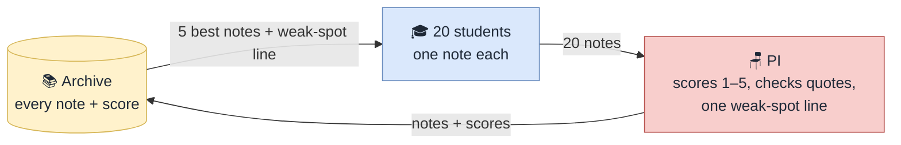

# The Library Journal Club: the loop

*Source: [journal_club_schematic.svg](journal_club_schematic.svg). Editable in a text editor or by importing into draw.io.*

The simplest self-improving architecture is a loop with an archive. That is what every system in [rsi.md](rsi.md) that keeps improving has in common (Darwin Gödel Machine, AlphaEvolve, AI co-scientist): generate, score, keep everything, and let the next round start from the best of what was kept.

## Four parts

| Part | Who | Does |
| --- | --- | --- |
| You | The human | Set the agenda at 10 pm. Read the minutes at 8 am. |
| 20 PhD students | One agent per paper in your library | Each writes one note per round: a claim, a critique of another paper, or an idea. |
| PI | One agent | Scores every note 1-5, checks that the quotes exist in the source, writes one line on what was weak this round. |
| Archive | One file, `events.jsonl` | Every note with its score. Never deleted. The minutes and the Zotero notes are read from it. |

## One round

Three rounds overnight. Round 1 has an empty archive, so the students write from their paper and the agenda alone. Rounds 2 and 3 start from the archive.

## What this loop gives you for free

- **Disputes**: a critique note that scores high *is* a dispute; the PI's score is the verdict.
- **Collaborations**: an idea note names two papers; that is the green edge.
- **Minutes**: the top-scored notes of the night, grouped by type.
- **Zotero**: each paper's notes, written back after round 3.

## Cost

About 25 calls per round (20 notes, 1 batched scoring call per 5 notes, 1 weak-spot line), ~80 for the night.

## Why it is enough

The review found that compounding needs three things: an archive that never discards, a selection rule, and a scorer ([rsi.md](rsi.md) §b). This loop has all three and nothing else. Everything in the earlier versions (groups, leads, discussants, debate turns, meta-review tournaments) is a refinement that can be added once this runs.
