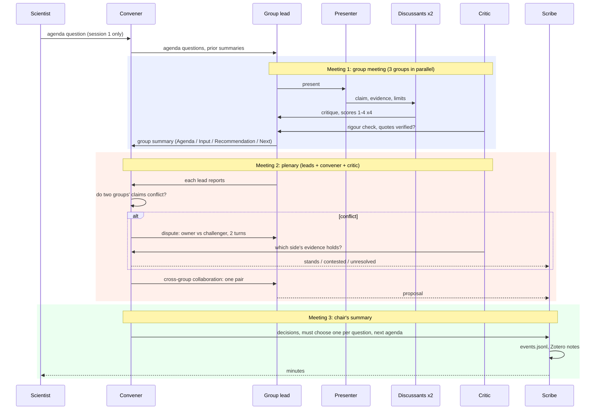

# The Library Journal Club as a research group

*Schematic source: [journal_club_schematic.svg](journal_club_schematic.svg). The Mermaid diagrams below give the same design as text.*

A hierarchical design modelled on how a real journal club runs: a convener chairs, topic groups meet first, group leads report to the plenary, the convener decides and the scribe writes the minutes. The hierarchy is Virtual Lab's (PI + standing Critic + scientist agents); the review rubric and the archive are ASCollab's; the dispute step is ours.

## 🏛️ The hierarchy

```mermaid
flowchart TB
    accTitle: Journal club hierarchy
    accDescr: The scientist sets the agenda. A convener agent chairs the club with a standing critic and a scribe. Papers are clustered into three topic groups, each with a group lead. Within a group, one paper presents and two discuss. The scribe writes everything to the event log, Zotero and the minutes.

    scientist["🧑‍🔬 Scientist<br/>sets the agenda, reads the minutes,<br/>settles what the convener could not"]

    subgraph chair["Chair (Virtual Lab PI + Critic)"]
        direction LR
        convener["🪑 Convener<br/>opens, synthesises, decides,<br/>sets next agenda"]
        critic["🔍 Critic<br/>standing; checks rigour and<br/>that quotes exist in the source"]
        scribe["✍️ Scribe<br/>structured minutes,<br/>events.jsonl, Zotero notes"]
    end

    subgraph groups["Topic groups (papers clustered by similarity, ~6-7 each)"]
        direction LR
        subgraph g1["Group 1"]
            lead1["👤 Group lead<br/>most central paper"]
            pres1["📄 Presenter"]
            disc1["📄 Discussants x2"]
            mem1["📄 Members"]
        end
        subgraph g2["Group 2"]
            lead2["👤 Group lead"]
            pres2["📄 Presenter"]
            disc2["📄 Discussants x2"]
            mem2["📄 Members"]
        end
        subgraph g3["Group 3"]
            lead3["👤 Group lead"]
            pres3["📄 Presenter"]
            disc3["📄 Discussants x2"]
            mem3["📄 Members"]
        end
    end

    archive[("📚 Archive<br/>events.jsonl, Zotero")]

    scientist -- agenda --> convener
    convener -- "agenda questions" --> lead1
    convener -- "agenda questions" --> lead2
    convener -- "agenda questions" --> lead3
    lead1 -- "group summary" --> convener
    lead2 -- "group summary" --> convener
    lead3 -- "group summary" --> convener
    critic -. "sits in every meeting" .-> convener
    convener -- "decisions, verdicts" --> scribe
    scribe --> archive
    archive -- minutes --> scientist

    classDef person fill:#ffedd5,stroke:#ea580c,stroke-width:2px,color:#7c2d12
    classDef chairrole fill:#fce7f3,stroke:#db2777,stroke-width:2px,color:#831843
    classDef leadrole fill:#ede9fe,stroke:#7c3aed,stroke-width:2px,color:#4c1d95
    classDef paper fill:#dbeafe,stroke:#2563eb,stroke-width:2px,color:#1e3a5f
    classDef store fill:#fef9c3,stroke:#ca8a04,stroke-width:2px,color:#713f12

    class scientist person
    class convener,critic,scribe chairrole
    class lead1,lead2,lead3 leadrole
    class pres1,disc1,mem1,pres2,disc2,mem2,pres3,disc3,mem3 paper
    class archive store
```

### Roles

| Role | Who | Does | Source |
| --- | --- | --- | --- |
| Scientist | Human | Writes the agenda question once; reads the minutes; settles `unresolved` | Virtual Lab (1.3% of words) |
| Convener | One agent, strongest model | Chairs; synthesises each round; must "choose one"; sets next agenda | Virtual Lab PI |
| Critic | One agent, standing | Last to speak in every meeting; checks rigour and that every quote exists in the source; feedback only | Virtual Lab Critic |
| Scribe | One agent, cheap model | Writes the structured summary and the Zotero notes; never argues | Virtual Lab summary format |
| Group lead | The most central paper in each cluster | Picks presenter and discussants; moderates; writes the group summary; reports to plenary | New; ResearchTown clustering |
| Presenter | One paper per group per session | States its claim, evidence, limits | Paper agent |
| Discussants | The 2 papers nearest the presenter | Critique on the ASCollab rubric (Support, Soundness, Significance, Originality 1-4) | ASCollab K=2 |
| Members | The rest of the group | May say "pass" or disagree | Virtual Lab team prompt |

Every agent is four fields: title, expertise, goal, role (Virtual Lab). Group leads and discussants are ordinary papers given a second system prompt for the session.

---

## 📅 One session

A session has three meetings, like a real journal club: group meetings in parallel, then the plenary, then the chair's summary.

Rules that keep it short:

- Group meetings use one shared transcript each; the lead speaks first and last (Virtual Lab round structure).
- Only the lead's summary reaches the plenary; transcripts stay in the group (Virtual Lab: summaries only cross meetings).
- Disputes are 2 turns, judged by the convener with the critic's evidence check. `unresolved` goes to the scientist.
- The convener must choose one answer per agenda question (Virtual Lab: agents hedge unless forced).

---

## 🌙 Three sessions overnight

Three sessions, each with a different purpose, the way a reading group would run a series.

```mermaid
flowchart LR
    accTitle: Three sessions overnight
    accDescr: Session one is introductions, where every paper presents inside its group. Session two is the debate, where the convener raises the conflicts found in session one. Session three is proposals, where groups pair up and the final minutes are written for the scientist.

    agenda["🧑‍🔬 Agenda<br/>10 pm"]
    s1["🔵 Session 1: Introductions<br/>every paper presents in its group<br/>leads map claims and conflicts"]
    s2["🟠 Session 2: Debate<br/>plenary on the conflicts<br/>verdicts: stands / contested / unresolved"]
    s3["🟢 Session 3: Proposals<br/>cross-group pairs propose ideas<br/>final minutes"]
    morning["☀️ Morning<br/>minutes, Zotero notes,<br/>unresolved for the scientist"]

    agenda --> s1
    s1 -- "claim map, conflict list" --> s2
    s2 -- "verdicts" --> s3
    s3 --> morning

    classDef one fill:#dbeafe,stroke:#2563eb,stroke-width:2px,color:#1e3a5f
    classDef two fill:#ffedd5,stroke:#ea580c,stroke-width:2px,color:#7c2d12
    classDef three fill:#dcfce7,stroke:#16a34a,stroke-width:2px,color:#14532d
    classDef person fill:#fef9c3,stroke:#ca8a04,stroke-width:2px,color:#713f12

    class s1 one
    class s2 two
    class s3 three
    class agenda,morning person
```

### Session 1: Introductions

Every paper presents once inside its group (6-7 presentations per group, two discussants each). The lead's summary lists each paper's main claim and marks where two members disagree. Plenary is short: the convener collects the three claim maps and writes the conflict list for session 2.

Output: claim per paper, conflict list, first Zotero notes ("presented at the club; discussants said ...").

### Session 2: Debate

No group meetings. The convener takes the conflict list to the plenary. For each conflict: the owning paper defends, the challenger counters, 2 turns; the critic says which side's quotes hold; the convener rules `stands`, `contested` or `unresolved`. Cap at 5 disputes.

Output: a verdict per conflict, red edges in the network view, `unresolved` list for the scientist.

### Session 3: Proposals

Groups meet again, but each group is paired with another: Group 1 with Group 2, Group 2 with Group 3, Group 3 with Group 1. The lead of each pair picks one paper from each side and asks for a combination ("Paper C's method on Paper D's data could test X"). The critic checks feasibility. The convener keeps the best proposal per pair and writes the final minutes.

Output: up to 3 proposals, green edges, final minutes: "Your 20 papers presented in 3 groups, raised 4 disputes (2 stand, 1 contested, 1 for you), and proposed 3 ideas."

### What changes between sessions

| | Session 1 | Session 2 | Session 3 |
| --- | --- | --- | --- |
| Who meets | Groups, in parallel | Plenary only | Paired groups |
| Who speaks | Every paper once | Only the papers in conflict | One pair per group pairing |
| Convener decides | Conflict list | Verdicts | Which proposals to keep |
| Critic checks | Quotes exist | Whose evidence holds | Feasibility |
| Scribe writes | Claim per paper | Verdict per dispute | Proposals, final minutes |

### Budget

Session 1: 20 presentations × (1 + 2 discussants + critic + lead) ≈ 100 calls. Session 2: ≤5 disputes × ~6 calls ≈ 30. Session 3: 3 pairings × ~8 calls ≈ 25. Chair and scribe overhead ≈ 20. **About 175 calls for the whole night**, which leaves room to run it twice.

---

## Why hierarchical, given the review

The evidence in [organisation_structure.md](organisation_structure.md) favours sparse, mediated communication over broadcast, and a chair who synthesises over free debate: Virtual Lab's PI synthesis each round, MetaGPT and ChatDev passing only artifacts between stages, MacNet's finding that only final outputs should travel along edges, and Du et al.'s saturation after a few rounds. A journal club gives that structure for free and is what the scientist already recognises. ASCollab's flat society is kept only in the review rubric and the archive; its lack of any dispute step is what session 2 fills.
