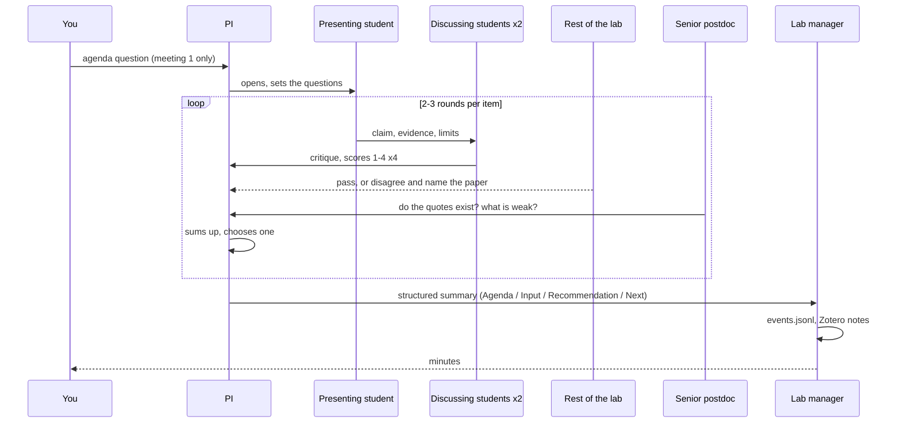

# The Library Journal Club as one lab

*Schematic source: [journal_club_schematic.svg](journal_club_schematic.svg). Editable in any text editor or by importing into draw.io.*

Think of it as a lab meeting. You are the scientist who owns the library. A PI agent runs the meeting, a senior postdoc agent is the tough reviewer, a lab manager agent keeps the minutes, and every paper in your Zotero library is a PhD student who knows that one paper inside out. The meeting format is Virtual Lab's team meeting; the scoring rubric and the archive are ASCollab's; the dispute step is ours.

## Who is in the lab

| Role | Who | Does | Borrowed from |
| --- | --- | --- | --- |
| You | The human | Set the agenda question once; read the minutes in the morning; settle what the PI marks `unresolved` | Virtual Lab (human writes ~1% of words) |
| PI | One agent, strongest model | Opens the meeting, sets the questions, sums up each round, rules on disputes, must "choose one" | Virtual Lab PI |
| Senior postdoc | One agent, standing | Speaks last every round; checks rigour and that every quote exists in the source; gives feedback, never writes the answer | Virtual Lab Scientific Critic |
| Lab manager | One agent, cheap model | Writes the structured minutes and the Zotero notes; never argues | Virtual Lab summary format |
| PhD students | 20 agents, one per paper | Each knows one paper: its claim, methods, data, limits | Paper agent (Paper2Agent) |
| ↳ Presenting student | One per turn | Presents their paper: claim, evidence, limits | |
| ↳ Two discussing students | The two with the closest topics | Discuss and score Support, Soundness, Significance, Originality 1-4 | ASCollab K=2 review |
| ↳ Rest of the lab | The other 17 | May say "pass", or disagree and name the paper | Virtual Lab team prompt |

Every agent is four fields: title, expertise, goal, role (Virtual Lab). A student is "discussing" only for that turn; it is a second system prompt, not a different agent.

## One lab meeting

House rules that keep it short:

- One shared transcript; each turn swaps the system prompt (Virtual Lab `run_meeting`). At most 5 students speak per item; the rest listen.
- Only the PI's summary leaves the meeting; the transcript stays in the lab.
- Disputes: when two students' papers clash, each defends with quotes for 2 turns; the PI rules `stands`, `contested` or `unresolved`. `unresolved` goes to you.
- The PI must choose one answer per question (agents hedge unless forced).

## Three meetings overnight

```mermaid
flowchart LR
    accTitle: Three lab meetings overnight
    accDescr: Meeting one is introductions, where every student presents their paper. Meeting two is the journal club debate on the conflicts the PI listed. Meeting three is the brainstorm, where the PI pairs students and the final minutes are written.

    agenda["🧑‍🔬 You set the agenda<br/>10 pm"]
    m1["🔵 Meeting 1: Introductions<br/>every student presents their paper<br/>PI lists the conflicts"]
    m2["🟠 Meeting 2: Journal club debate<br/>students in conflict argue, 2 turns<br/>stands / contested / unresolved"]
    m3["🟢 Meeting 3: Brainstorm<br/>PI pairs students, one idea per pair<br/>final minutes"]
    morning["☀️ Morning<br/>minutes, Zotero notes,<br/>unresolved items for you"]

    agenda --> m1
    m1 -- "claim per paper, conflict list" --> m2
    m2 -- "verdicts" --> m3
    m3 --> morning

    classDef one fill:#dbeafe,stroke:#2563eb,stroke-width:2px,color:#1e3a5f
    classDef two fill:#ffedd5,stroke:#ea580c,stroke-width:2px,color:#7c2d12
    classDef three fill:#dcfce7,stroke:#16a34a,stroke-width:2px,color:#14532d
    classDef person fill:#fef9c3,stroke:#ca8a04,stroke-width:2px,color:#713f12

    class m1 one
    class m2 two
    class m3 three
    class agenda,morning person
```

| | Meeting 1: Introductions | Meeting 2: Journal club debate | Meeting 3: Brainstorm |
| --- | --- | --- | --- |
| Who speaks | Every student once, 2 discussants each | Only the students in conflict | One pair at a time, ~4 pairs |
| PI decides | The conflict list | Verdicts, cap 5 disputes | Which ideas to keep |
| Postdoc checks | Quotes exist | Whose evidence holds | Feasibility |
| Lab manager writes | Claim per paper, first Zotero notes | Verdict per dispute, red edges | Ideas, green edges, final minutes |

Budget: meeting 1 ≈ 20 × (presenter + 2 discussants + postdoc + PI) ≈ 100 calls; meeting 2 ≈ 5 disputes × 6 ≈ 30; meeting 3 ≈ 4 pairs × 6 ≈ 25; lab manager ≈ 15. **About 170 calls for the night.**

## Why one lab

Twenty papers is the size of one reading group, and the review in [organisation_structure.md](organisation_structure.md) favours a chair who sums up and summaries that travel instead of transcripts (Virtual Lab, MetaGPT, ChatDev, MacNet). Splitting into topic groups adds a layer of leads and summaries that only pays off above ~16 active participants per meeting (MacNet's saturation point); with 5 students speaking per item there is no need. ASCollab's flat society is kept only in the rubric and the archive; its missing dispute step is meeting 2.
