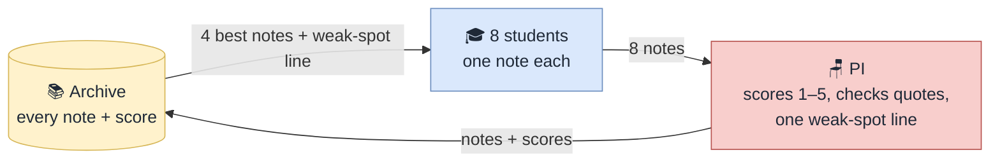

# The Library Journal Club: the loop

*Source: [journal_club_schematic.svg](journal_club_schematic.svg). Editable in a text editor or by importing into draw.io.*

The simplest self-improving architecture is a loop with an archive. That is what every system in [rsi.md](rsi.md) that keeps improving has in common (Darwin Gödel Machine, AlphaEvolve, AI co-scientist): generate, score, keep everything, and let the next round start from the best of what was kept.

## Four parts

| Part | Who | Does |
| --- | --- | --- |
| You | The human | Set the agenda at 10 pm. Read the minutes at 8 am. |
| 8 PhD students | One agent per paper in your library | Each writes one note per round: a claim, a critique of another paper, or an idea. |
| PI | One agent | Scores every note 1-5, checks that the quotes exist in the source, writes one line on what was weak this round. |
| Archive | One file, `events.jsonl` | Every note with its score. Never deleted. The minutes and the Zotero notes are read from it. |

## One round

Three rounds overnight. Round 1 has an empty archive, so the students write from their paper and the agenda alone. Rounds 2 and 3 start from the archive.

## The self-improvement, spelled out

The green arrow in the schematic (archive → students) is the whole point. It carries four things, and each maps to a mechanism the review found in systems that actually compound ([rsi.md](rsi.md) §b):

| Ingredient | In the loop | Borrowed from | Without it |
| --- | --- | --- | --- |
| 1. Never discard | Every note stays in `events.jsonl` with its score | Darwin Gödel Machine archive; ADAS | Round 2 repeats round 1 |
| 2. Select | Each student reads the 4 best-scored notes before writing | DGM parent sampling; AlphaEvolve program database | Everyone writes about everything; no direction |
| 3. Feedback | The PI's one weak-spot line is prepended to every prompt | AI co-scientist meta-review digest | Scores go up and down; nothing is learned from them |
| 4. External check | The PI searches the literature for the top idea each round | Every compounding system has a hard evaluator | The loop drifts toward what the PI's model likes (Huang et al.; Moltbook trilemma) |

Without 1-3 it is a pipeline. Without 4 it is a mirror.

### Round by round

| | Round 1: cold | Round 2: warm | Round 3: focused |
| --- | --- | --- | --- |
| Reads | The paper + your agenda | 4 best notes + PI's line | 4 best notes + PI's line |
| Archive | 0 → 8 notes | 8 → 16 | 16 → 24 |
| Expect | Mostly claims; critiques generic ("sample is small"); ideas pair obvious neighbours | Critiques quote and target the weak spot; students answer round-1 critiques of their paper; ideas build on scored ones | Ideas are falsifiable and cite two passages; top idea has a literature verdict; duplicates gone |
| PI's line, e.g. | "critiques did not quote the passage they attack" | "ideas do not say what result would falsify them" | stop here |

**Measure it, do not assume it.** Log per round the share of quotes that string-match the source and the mean PI score. If neither rises, say "rounds change", not "rounds get better". Gains from an LLM scorer flatten after 3-4 rounds ([rsi.md](rsi.md) §c), which is why the night stops at three.

## What this loop gives you for free

- **Disputes**: a critique note that scores high *is* a dispute; the PI's score is the verdict.
- **Collaborations**: an idea note names two papers; that is the green edge.
- **Minutes**: the top-scored notes of the night, grouped by type.
- **Zotero**: each paper's notes, written back after round 3.

## Cost

About 12 calls per round (8 notes, 2 batched scoring calls, 1 weak-spot line, 1 novelty check), ~40 for the night.

## Can it generate new hypotheses?

Yes, candidate ones. The "idea" note type is the hypothesis generator, and with 8 papers the space is small enough to cover: 28 pairs, 24 notes over three rounds. What the loop does and does not guarantee:

- **It will produce hypotheses.** An idea note is "paper X's method on paper Y's data would test Z". ASCollab and the AI co-scientist both produced hypotheses this way that later papers confirmed ([ascollab.md](ascollab.md) §7, [rsi.md](rsi.md) #7); the mechanism is combination across sources plus a scorer.
- **"New" means new relative to the 8 papers, unless the PI can search.** The loop only sees the archive and the 8 papers. Add one call per round: the PI searches the wider literature (Semantic Scholar or arXiv) for the top idea and marks it `not found` / `already published`. Without that, say "new to this library", not "new".
- **Rounds change ideas; they do not reliably improve them.** With an LLM scorer and no external check, gains flatten within 3-4 rounds ([rsi.md](rsi.md) §c). Three rounds is the right number.
- **Make the idea note strict.** Must name two papers, quote one passage from each with its location, and state what result would falsify it. The PI rejects ideas that fail this; that is the only quality gate and it is cheap.
- **They are candidates.** Both anchor papers say so on stage; so should you.

## Why it is enough

The review found that compounding needs three things: an archive that never discards, a selection rule, and a scorer ([rsi.md](rsi.md) §b). This loop has all three and nothing else. Everything in the earlier versions (groups, leads, discussants, debate turns, meta-review tournaments) is a refinement that can be added once this runs.
